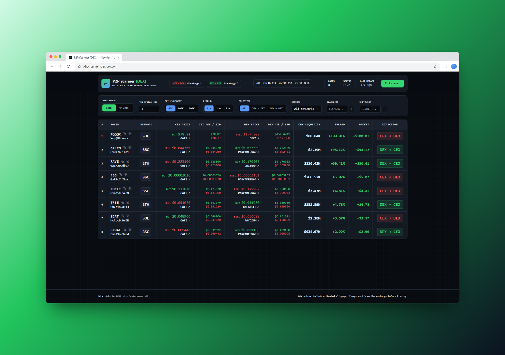

<div align="center">

# ⇌ P2P Scanner [DEX] — CEX ↔ DEX Arbitrage

**Gate.io against every DEX, in one table.**
A real-time arbitrage scanner that matches Gate.io spot markets with on-chain pools from
DexScreener by contract address — with fees, slippage, gas and a hedged execution plan.

[](https://nextjs.org/)
[](https://react.dev/)
[](https://www.typescriptlang.org/)
[](https://tailwindcss.com/)
[](https://nodejs.org/)
[](LICENSE)



</div>

---

## 📋 Table of Contents

- [✨ Features](#-features)
- [🧰 Tech Stack](#-tech-stack)
- [🚀 Quick Start](#-quick-start)
- [🔍 How a Scan Works](#-how-a-scan-works)
- [🧮 Profit Model](#-profit-model)
- [🛡️ Hedged Strategies](#️-hedged-strategies)
- [🔌 API](#-api)
- [📜 Scripts](#-scripts)
- [🗂️ Project Structure](#️-project-structure)
- [⚠️ Limitations](#️-limitations)
- [🗺️ Roadmap](#️-roadmap)
- [📄 License](#-license)

---

## ✨ Features

|                              |                                                                                          |
| ---------------------------- | ---------------------------------------------------------------------------------------- |
| 🔗 **Matched by contract**   | Gate.io currencies are paired with DEX pools by `(network, contract address)`, not ticker |
| ↔️ **Both directions**       | **DEX → CEX** (buy on-chain, sell on Gate) and **CEX → DEX** (buy on Gate, sell on-chain) |
| 💸 **Real costs**            | Gate taker fee, DEX pool fee and liquidity-based slippage are priced into every spread   |
| ⛽ **Live gas**              | ETH / BSC swap cost from Owlracle, SOL fixed — shown in the header, used in strategies    |
| 🛡️ **Hedged strategies**     | Step-by-step plan with a Gate Futures short covering the withdraw / deposit window       |
| 🎛️ **Filters**               | Trade amount, min spread, min DEX liquidity, direction, multi-network select             |
| 🚫 **Blacklist / whitelist** | Hide tickers or highlight them; both lists are kept in `localStorage`                    |
| 📌 **Pin a token**           | Keep one row on screen while the table re-sorts; the pinned token feeds the strategies   |
| ⏱️ **Auto-refresh**          | 1 / 2 / 5 min, live status (Live / Stale), progress of a running scan                    |
| 🔗 **One-click links**       | Gate market, DEX swap, DexScreener, explorer and CoinMarketCap; copy-to-clipboard        |

> No database and no API keys — only public endpoints of Gate.io, DexScreener and Owlracle.

---

## 🧰 Tech Stack

| Layer     | Technology                                                        |
| --------- | ----------------------------------------------------------------- |
| Framework | **Next.js 16** (App Router, Turbopack)                            |
| UI        | **React 19**, **Tailwind CSS 3**                                  |
| Language  | **TypeScript** — `strict`                                         |
| Data      | Gate.io REST v4 · DexScreener API · Owlracle gas API              |
| Cache     | In-memory on the server — scan results 30 s, gas prices 10 min    |

---

## 🚀 Quick Start

**Requirements:** Node.js **24.x** (20.9+ works as well).

```bash
# 1. Clone
git clone https://github.com/lpcms/p2p-scanner-dex-cex.git
cd p2p-scanner-dex-cex

# 2. Install dependencies
npm install

# 3. Start the dev server
npm run dev
```

Open **http://localhost:3000**. The first full scan takes about a minute — the table fills in
when it finishes, later refreshes are served from the cache.

---

## 🔍 How a Scan Works

The pipeline lives in [`lib/scanner.ts`](lib/scanner.ts):

1. **Gate.io currencies** — every listed currency with its networks and contract addresses
   (`/spot/currencies`). Native coins without a contract and networks with both deposit and
   withdrawal disabled are skipped.
2. **Tickers** — only `*_USDT` pairs with more than **$5,000** of 24h volume.
3. **Order books** — top 5 levels per pair, 10 requests in parallel → best bid and ask.
4. **DexScreener** — contract addresses in batches of **30** → pools with price and liquidity.
5. **Best pool** — per network, preferring stable / major quote assets (USDT, USDC, WETH, WBNB …)
   ([`pickBestPool`](lib/dexscreener.ts)).
6. **Arbitrage** — both directions are computed, the better one becomes the row's direction.

Gate network names are mapped to DexScreener chain IDs in
[`gateChainToDexScreener`](lib/gate.ts) — Ethereum, BSC, Solana, Arbitrum, Base, Optimism,
Polygon, Avalanche and 20+ more.

---

## 🧮 Profit Model

Implemented in [`lib/arbitrage.ts`](lib/arbitrage.ts):

| Component      | Value                                                                   |
| -------------- | ----------------------------------------------------------------------- |
| Gate taker fee | **0.1%**                                                                |
| DEX pool fee   | **0.3%** (typical v2 tier)                                              |
| DEX slippage   | `trade / (liquidity / 2)` — constant-product estimate, capped at 100%   |

```text
DEX → CEX:  buy  on DEX at  price × (1 + slippage) × (1 + pool fee)
            sell on Gate at bid   × (1 − taker fee)

CEX → DEX:  buy  on Gate at ask   × (1 + taker fee)
            sell on DEX at  price × (1 − slippage) × (1 − pool fee)
```

The slippage estimate is a safe upper bound: concentrated-liquidity (v3) pools usually slip less,
so the real profit tends to be better than shown. Changing **Trade Amount** recalculates every row
on the client without a new scan.

---

## 🛡️ Hedged Strategies

**Strategy 1** and **Strategy 2** in the header open a step-by-step plan for the **pinned** token
([`lib/strategy.ts`](lib/strategy.ts)):

| Strategy           | Steps                                                                                     |
| ------------------ | ----------------------------------------------------------------------------------------- |
| **1 · CEX → DEX**  | Buy spot on Gate → open a Futures **short** → withdraw to the network → sell on the DEX → close the short |
| **2 · DEX → CEX**  | Open a Futures **short** → buy on the DEX → deposit to Gate → sell spot → close the short  |

The short neutralises price moves during the withdraw / deposit window. The plan includes Gate
spot and futures fees (0.1% / 0.05%), the real withdrawal fee for that network
(`/wallet/withdraw_status`), live gas and estimated timing. If Gate has no perpetual contract
for the token, the plan says so and runs unhedged.

---

## 🔌 API

All routes are dynamic and return `{ ok: true, ... }` or `{ ok: false, error }`.

| Route                                                                   | Purpose                                                          |
| ----------------------------------------------------------------------- | ---------------------------------------------------------------- |
| `GET /api/scan?amount=1000`                                             | Latest scan results; starts a new scan when the cache is > 30 s   |
| `GET /api/scan?amount=1000&force=1`                                     | Force a fresh scan                                               |
| `GET /api/strategy?pair=PEPE_USDT&chain=ETH&amount=1000&direction=CEX_TO_DEX` | Hedged strategy for a token from the latest scan            |
| `GET /api/gas`                                                          | Swap gas in USD for `ethereum`, `bsc`, `solana` (10 min cache)    |
| `GET /api/gate-pairs`                                                   | Debug: Gate currencies with their networks and contracts          |

`amount` accepts `100`, `1000` or `10000`; `direction` is `CEX_TO_DEX` or `DEX_TO_CEX`.

---

## 📜 Scripts

| Command             | Description                                 |
| ------------------- | ------------------------------------------- |
| `npm run dev`       | Development server on http://localhost:3000 |
| `npm run build`     | Production build                            |
| `npm start`         | Production server (after `npm run build`)   |
| `npm run typecheck` | TypeScript check (`tsc --noEmit`)           |

---

## 🗂️ Project Structure

```text
p2p-scanner-dex-cex/
├── app/
│   ├── api/
│   │   ├── scan/route.ts        # main scanner endpoint (30 s cache)
│   │   ├── strategy/route.ts    # hedged strategy for one token
│   │   ├── gas/route.ts         # swap gas per network
│   │   └── gate-pairs/route.ts  # debug: Gate currencies and contracts
│   ├── layout.tsx
│   ├── page.tsx                 # state, filtering, auto-refresh, lists
│   ├── globals.css
│   └── icon.svg
├── components/
│   ├── Header.tsx               # logo, strategies, gas, status, refresh
│   ├── Filters.tsx              # amount, spread, liquidity, direction, networks, lists
│   ├── ResultsTable.tsx         # arbitrage table
│   ├── PinnedTokenCard.tsx      # pinned row
│   ├── StrategyModal.tsx        # step-by-step hedged plan
│   ├── GasPrices.tsx
│   ├── NetworkMultiSelect.tsx
│   ├── CopyButton.tsx
│   └── RelativeTime.tsx
├── lib/
│   ├── scanner.ts               # scan pipeline + in-memory cache
│   ├── arbitrage.ts             # fees, slippage, spread and profit
│   ├── strategy.ts              # hedged strategy calculation
│   ├── gate.ts                  # Gate.io client, network mapping, explorers
│   ├── dexscreener.ts           # DexScreener client, pool choice, swap links
│   ├── gas.ts                   # Owlracle gas with cache
│   └── format.ts
├── types/                       # shared types
└── docs/
    └── preview.png              # README screenshot
```

---

## ⚠️ Limitations

> **This is an indicative scanner, not a trading bot.** Always verify quotes on the exchange
> before trading.

- **DexScreener prices are aggregated**, not executable swap quotes.
- **Withdrawal fees** are included only in the strategy plan, not in the table — on small amounts
  they often eat the whole spread.
- **Transfer time** — the price can move while a withdrawal or deposit is confirming; that is what
  the futures hedge is for.
- **In-memory cache** — one cache per server instance; serverless platforms may scan more often.
- **Rate limits** — Gate.io ~200 req/s, DexScreener ~300 req/min; concurrency is conservative.

---

## 🗺️ Roadmap

- 📈 Executable DEX quotes via 1inch / 0x / Jupiter instead of the slippage estimate.
- 💸 Withdrawal fees in the table, not only in the strategy.
- 📡 Gate WebSocket order books instead of REST polling.
- 🗃️ Spread history and charts.
- 🔔 Telegram alerts for spreads above a threshold.

---

## 📄 License

Distributed under the **Apache License 2.0** — see [LICENSE](LICENSE).

<div align="center">

Made with ❤️ for traders who hunt the spread ⇌

</div>
